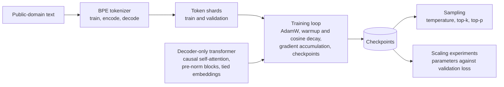

# tiny-llm

A small GPT-style language model written in PyTorch, with every part in the open: a
byte-pair-encoding tokenizer, a decoder-only transformer, a training loop, sampling, and
scaling experiments that measure how validation loss falls as the model grows. It trains
on a laptop CPU on public-domain text.

> **Status:** design stage. The design doc and roadmap are written; the tokenizer is the
> first piece being built. No loss curve or sample appears here until a run has produced
> it, and every result will state the hardware it was measured on.

## Why build a small one

Large models are used through an API and their internals are easy to describe and hard
to check. A model small enough to train in an afternoon on a CPU can be tested end to
end: that the attention mask really hides the future, that the learning rate schedule
does what its plot says, that a checkpoint resumes to the same loss. This project is
that model, with the tests.

## What it will contain



| Part | What it does |
|---|---|
| Tokenizer | Byte-level BPE trained on the corpus; exact round trip for any text |
| Model | Token and position embeddings, causal multi-head self-attention, MLP blocks, weight tying |
| Training | AdamW, linear warmup then cosine decay, gradient accumulation and clipping, mixed precision where the device supports it, resumable checkpoints |
| Sampling | Temperature, top-k and nucleus sampling from a checkpoint |
| Experiments | The same data and budget across several model sizes, with charts in `docs/` |

## Honest limits

There is no GPU here. Models are a few million parameters, trained on tens of megabytes
of text. The goal is a correct, tested, measured implementation, not a model that
competes with anything.

Checkpoints from this project are the models that
[llm-inference-server](https://github.com/mohammadazam7/llm-inference-server) loads and
serves.

## Documentation

- [Design doc](docs/design.md): goals, non-goals, design, alternatives, testing plan
- [Roadmap](docs/ROADMAP.md): milestones and dates

## Development

```bash
python -m venv .venv && source .venv/bin/activate
make install
make check
```

See [CONTRIBUTING.md](CONTRIBUTING.md) and [SECURITY.md](SECURITY.md).

## License

MIT
