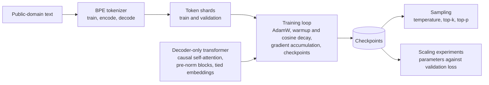

# tiny-llm

A small GPT-style language model written in PyTorch, with every part in the open: a
byte-pair-encoding tokenizer, a decoder-only transformer, a training loop, sampling, and
scaling experiments that measure how validation loss falls as the model grows. It trains
on a laptop CPU on public-domain text.

> **Status:** milestone 2. The tokenizer, data preparation and the model are in place and
> tested; the training loop comes next. No loss curve or sample appears here until a run
> has produced it, and every result will state the hardware it was measured on.

## Why build a small one

Large models are used through an API and their internals are easy to describe and hard
to check. A model small enough to train in an afternoon on a CPU can be tested end to
end: that the attention mask really hides the future, that the learning rate schedule
does what its plot says, that a checkpoint resumes to the same loss. This project is
that model, with the tests.

## What it will contain



| Part | What it does |
|---|---|
| Tokenizer | Byte-level BPE trained on the corpus; exact round trip for any text |
| Model | Token and position embeddings, causal multi-head self-attention, MLP blocks, weight tying |
| Training | AdamW, linear warmup then cosine decay, gradient accumulation and clipping, mixed precision where the device supports it, resumable checkpoints |
| Sampling | Temperature, top-k and nucleus sampling from a checkpoint |
| Experiments | The same data and budget across several model sizes, with charts in `docs/` |

## Data and tokenizer

The corpus is Tiny Shakespeare (about 1.1 MB of plays, public domain), downloaded from a
pinned commit and checked against its SHA-256 by `scripts/fetch_corpus.sh`. The last
10 percent, cut at a line break, is held out for validation, and the tokenizer is
trained on the rest only.

```bash
scripts/fetch_corpus.sh                       # data/raw/tinyshakespeare.txt
tiny-llm prepare data/raw/tinyshakespeare.txt --vocab-size 512
```

Characters per token, the tokenizer's compression, measured on the training text and on
the held-out text it never saw:

| Vocabulary | Training text | Held-out text | Time to prepare |
|---|---|---|---|
| 256 (bytes only) | 1.00 | 1.00 | 0.4 s |
| 512 | 1.96 | 1.90 | 7.4 s |
| 1,024 | 2.45 | 2.28 | 19.7 s |
| 2,048 | 2.91 | 2.59 | 40.5 s |

The gap between the two columns grows with the vocabulary: larger vocabularies learn
merges that fit the training plays more than English in general. Measured on two cores
of an Intel Xeon at 2.1 GHz with the pure Python tokenizer.

## The model

`tiny_llm.model.TinyLM` is a decoder-only transformer in about 200 lines. Token and
learned position embeddings feed pre-norm blocks of causal self-attention and a GELU MLP;
the output head shares its weights with the token embedding. Attention is written out by
hand, so the causal mask is a line of code the tests can check and the attention weights
of every layer can be read back with `model.attention(tokens)`.

```python
import torch
from tiny_llm.model import ModelConfig, TinyLM

config = ModelConfig(vocab_size=1024, context=128, layers=4, heads=4, width=128)
model = TinyLM(config)
logits = model(torch.randint(0, 1024, (8, 128)))   # (8, 128, 1024)
config.parameter_count()                            # 940,800
```

The parameter count is a formula, `V*W + C*W + L*(12*W*W + 13*W) + 2*W` for vocabulary
V, context C, width W and L layers, and a test holds the model to it. With a vocabulary
of 1,024 and a context of 128:

| Layers | Heads | Width | Parameters | In the embeddings |
|---|---|---|---|---|
| 2 | 2 | 64 | 173,824 | 42% |
| 4 | 4 | 128 | 940,800 | 16% |
| 6 | 6 | 192 | 2,890,752 | 8% |
| 8 | 8 | 256 | 6,613,504 | 4% |

These are the sizes the scaling experiments will train. What the tests check before any
training: changing a token never changes an earlier prediction, attention weights above
the diagonal are exactly zero, the loss of a fresh model is close to ln(V) (a uniform
guess), every parameter receives a gradient, and one batch can be memorised.

## Honest limits

There is no GPU here. Models are a few million parameters, trained on tens of megabytes
of text. The goal is a correct, tested, measured implementation, not a model that
competes with anything.

Checkpoints from this project are the models that
[llm-inference-server](https://github.com/mohammadazam7/llm-inference-server) loads and
serves.

## Documentation

- [Design doc](docs/design.md): goals, non-goals, design, alternatives, testing plan
- [Roadmap](docs/ROADMAP.md): milestones and dates

## Development

```bash
python -m venv .venv && source .venv/bin/activate
make install
make check
```

See [CONTRIBUTING.md](CONTRIBUTING.md) and [SECURITY.md](SECURITY.md).

## License

MIT
